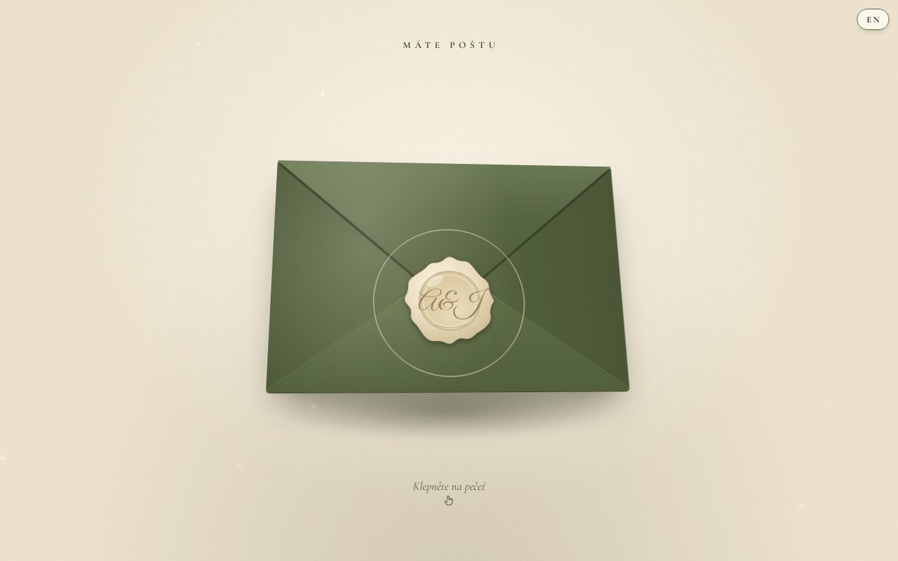
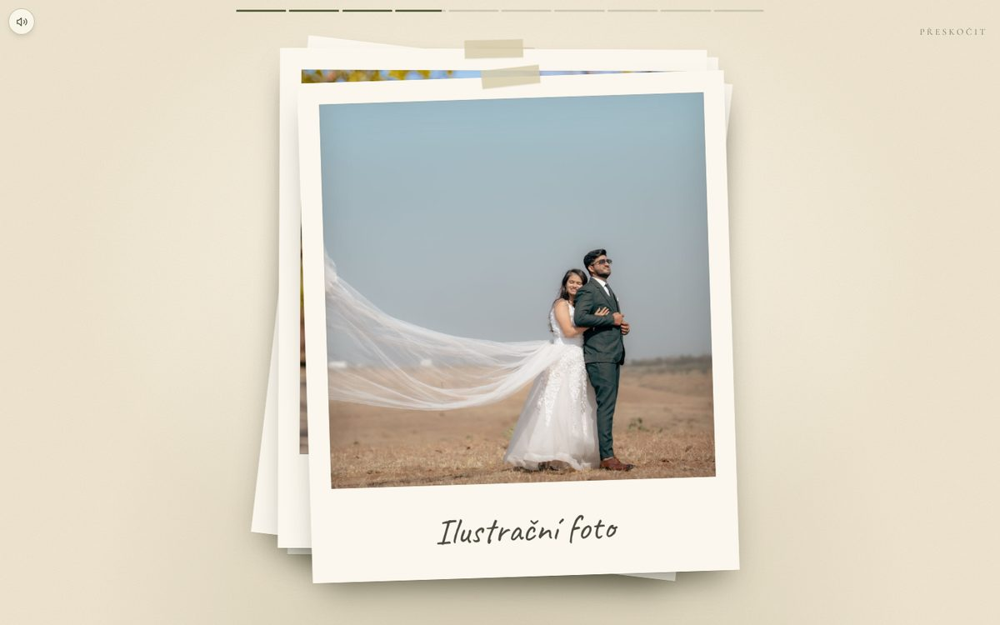
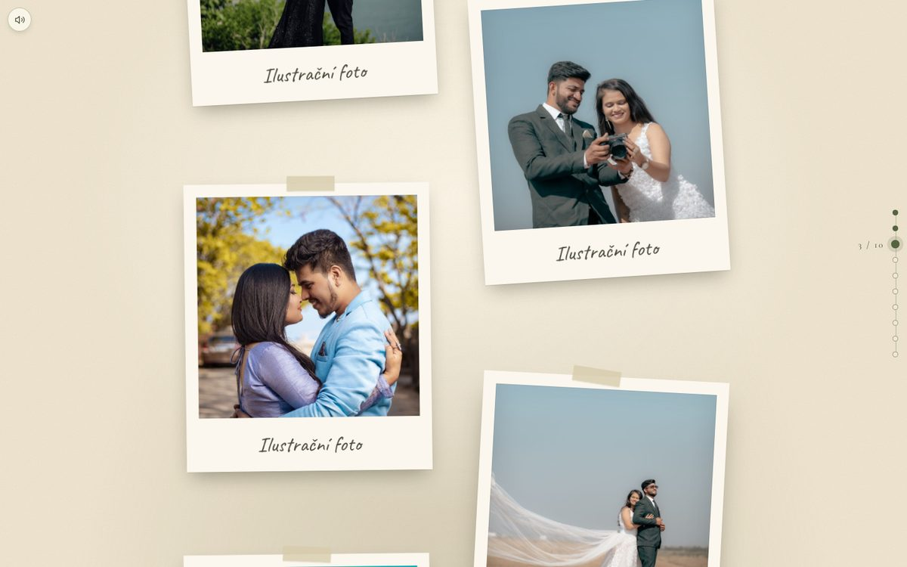
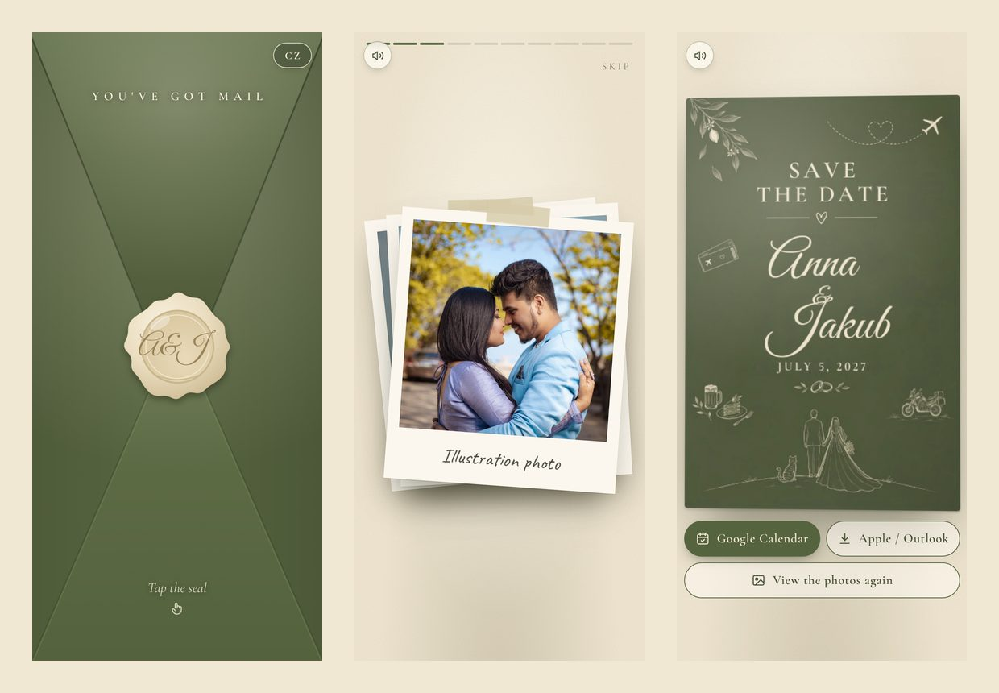
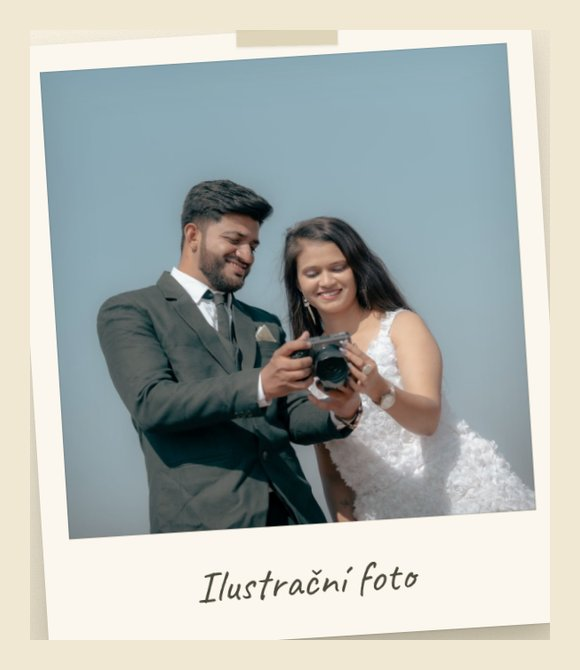

# Wedding Invitation

An animated wedding invitation sent as a link: a 3D envelope with a wax seal opens, your photos fly out and drop onto a pile one by one, and the Save the Date pops up with buttons to add the day to a calendar.

   

**Live demo:** [firestone82.github.io/WeddingInvitation](https://firestone82.github.io/WeddingInvitation/) ([English](https://firestone82.github.io/WeddingInvitation/en/))

## About

A Next.js app in TypeScript, exported as a static site, so it runs on GitHub Pages or any plain web host. Everything you change lives in a few files: the wedding details in `src/config/wedding.ts`, the texts in `src/i18n/messages/`, and the photos with their captions in `public/photos/` and `content/photos.json`. Languages are configurable: the demo comes in Czech and English with Czech as the default, and adding another one is a new messages file plus one line of config. It works on phones, tablets and computers, and the demo uses placeholder names, illustration photos from Pexels and an original music-box tune.

## Features

- Envelope that follows the cursor (or the phone's tilt), fills the screen edge to edge on phones, and opens when the seal is tapped: the seal cracks, leaves burst out, the flap swings open
- Photos fly out of the envelope towards you, then drop onto a pile one at a time and "develop" like real polaroids
- Save the Date that flips in, can be timed to a beat of the song, and has **Google Calendar** and **Apple / Outlook (.ics)** buttons
- Afterwards guests can scroll back through all the photos and open any of them full size (swipe, arrow keys, Esc)
- Music that starts on the tap of the seal, with a mute button
- Any number of languages, each at `/<code>/`, with the default one at the root; personal greeting with `?pro=`; respects "reduce motion"

## Showcase

The envelope tilts towards the cursor and waits for a tap on the seal.



The flap opens and the photos fly out, then drop onto the pile one by one.




The Save the Date, with the calendar buttons under it.


All photos can be looked through again; a click opens one full size.



On a phone (English page): envelope, photo show, invitation.



## Run locally

Needs Node.js 20.9 or newer.

```bash
npm install
npm run dev          # http://localhost:3000, reloads as you edit
```

`/en/` opens the English page. Add `?open` to the address to skip the envelope while you are tweaking the page.

To check the finished site the way guests get it:

```bash
npm run build        # writes the static site to out/
npm start            # serves out/ at http://localhost:3000
```

## Make it yours

- **Wedding details**: `src/config/wedding.ts` holds the names, the monogram on the seal, the date and time, the place, a map link, the calendar event, the Save the Date pictures, the music and the timing of the photo show. Each setting is described in `src/config/types.ts`.
- **Values per language**: any text or file name in the config can be one value for every language or one per language code. A language that is missing falls back to the default language.

  ```ts
  place: "Zámek Lednice",
  calendar: {
    title: {
      cs: "Svatba Anny a Jakuba",
      en: "Anna & Jakub's wedding",
    },
  },
  ```

- **Texts**: everything shown on the page is in `src/i18n/messages/<code>.ts`, one file per language. The list of texts is in `src/i18n/types.ts`, so a missing one is a type error.
- **Photos**: copy your pictures into `public/photos/` (named so they sort in order, e.g. `01.jpg`) and run `npm run photos`. It updates `content/photos.json` and keeps the captions you already wrote. The first `show.flyCount` photos are the ones that fly out of the envelope.
- **Polaroid captions**: see below.
- **Save the Date**: `public/invite/cs.webp` and `public/invite/en.webp`, portrait 2:3; the file names are set in `inviteImage`.
- **Music**: replace `public/music.mp3`. To make the Save the Date pop up on a beat, set `music.revealAt` to that second of the song; with `music.start: "auto"` the song then starts at the point that lands the reveal exactly there, with each photo on screen for `show.photoInterval` seconds.
- **Personal greeting**: `?pro=Milá%20Jano` writes "Milá Jano" on the envelope.
- **Colours and fonts**: the colours are at the top of `src/app/globals.css`; the fonts are self-hosted in `src/fonts/` and loaded in `src/app/fonts.ts`.

## Languages

The languages and the default one are set in `src/config/wedding.ts`:

```ts
defaultLanguage: "cs",
languages: [
  {
    code: "cs",
    label: "CZ",
    locale: "cs-CZ",
  },
  {
    code: "en",
    label: "EN",
    locale: "en-GB",
  },
],
```

Every language gets its own page at `/<code>/`; the root address `/` shows `defaultLanguage`. The envelope shows a switch to each other language. To add one, for example German:

1. Copy `src/i18n/messages/en.ts` to `src/i18n/messages/de.ts` and translate it.
2. Register it in `src/i18n/index.ts`: `import de from "./messages/de";` and add `de` to `messages`.
3. Add `{ code: "de", label: "DE", locale: "de-DE" }` to `languages`, and German values wherever the config has per-language values (a Save the Date picture, calendar texts, captions).

The build stops with a clear error if a configured language has no messages file, or if `defaultLanguage` is not in the list.

## Polaroid captions

Every photo is described in `content/photos.json`; the order of the list is the order on the page. The caption is the handwritten line under the photo, on the pile and in the scrollable story.



```json
[
  {
    "file": "01.jpg",
    "caption": {
      "cs": "Ilustrační foto",
      "en": "Illustration photo"
    },
    "position": "55% 45%"
  },
  {
    "file": "02.jpg",
    "caption": "Paris 2024"
  },
  {
    "file": "03.jpg",
    "caption": ""
  }
]
```

| Field | Meaning |
|---|---|
| `file` | file name in `public/photos/` (or a full URL) |
| `caption` | text under the photo: one text for every language, one per language code, or `""` for a blank footer |
| `position` | optional, where the square crop is centred (`"50% 30%"` shows more of the top); the full-size view always shows the whole photo |
| `alt` | optional description for screen readers, one text or one per language; defaults to the caption |

The demo photos are captioned "Ilustrační foto / Illustration photo" to make clear they are not the couple's own.

## Deploying

`npm run build` writes the whole site to `out/`: the root page, one folder per language, and the photos, music and pictures with a version stamp in their links so browsers and CDNs fetch fresh files after every change.

**GitHub Pages** is set up in `.github/workflows/deploy.yml`: every push to `master` type-checks, builds and publishes the site; pull requests are only built. The workflow sets the base path (e.g. `/WeddingInvitation`) automatically. One-time setup: **Settings → Pages → Source: GitHub Actions**. The site then appears at `https://<user>.github.io/<repo>/`.

**Any other host** (nginx, Netlify, …): run `npm run build` and upload the contents of `out/`. For a subfolder instead of the domain root, build with `BASE_PATH=/subfolder npm run build`. `SITE_URL=https://example.com` makes link previews use absolute addresses.

## Where things are

```
src/
  config/
    wedding.ts           wedding details, languages, timing, music   ← edit this
    types.ts             what each setting means
  i18n/
    messages/cs.ts       texts in Czech                              ← and these
    messages/en.ts       texts in English
    index.ts             registered languages, per-language values
  app/
    (default)/           the root page, in the default language
    [lang]/              one page per language
    globals.css          look and animations
    fonts.ts             self-hosted fonts
  components/
    Invitation.tsx       puts it all together and runs the sequence
    Envelope.tsx         envelope, seal, opening animation
    PhotoShow.tsx        photos dropping onto the pile
    PhotoStory.tsx       scrollable polaroids with progress dots
    InviteSection.tsx    Save the Date and calendar buttons
    Lightbox.tsx         full-size view
  lib/                   calendar, music, timing, effects, photo list
  fonts/                 Great Vibes, Cormorant Garamond, Caveat
content/
  photos.json            order, captions, crop positions
public/
  photos/                photos, and CREDITS.md for the demo ones
  invite/                Save the Date pictures
  music.mp3              music
scripts/
  photos.mjs             rebuilds photos.json from the folder
```

## Credits

Demo photos are illustration photos from [Pexels](https://www.pexels.com/search/pre%20wedding/) (Pexels License), see [public/photos/CREDITS.md](public/photos/CREDITS.md). The music-box tune is original and free to use. Fonts from Google Fonts under the SIL Open Font License.
